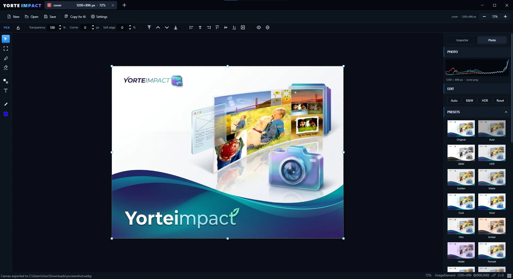

<p align="center">
  
</p>

# YorteImpact

A fast desktop tool for prototyping page layouts: place shapes, images and
text on a canvas, style them, slice regions and export the result. Built with
WPF on .NET 8.

- Flat Z-order (bring forward / back), no layer tree.
- Vector shapes (rectangle, ellipse, triangle and custom polygon) with solid or
  gradient fills, borders, corner radius, shadows, soft edges and directional
  transparency.
- Editable vector lines and arrows with freehand curves, endpoint markers,
  solid/dashed/dotted strokes and shadows.
- Editable text with RTL support, font search, wrapping, spacing and shadows.
- Raster paintbrush for freehand painting, photo retouching (smudge/blur),
  watercolor, erasing and blending an image into the background behind it.
- Slice-based copy, cut and export; transparent PNG output.
- Image import from the clipboard or by drag-and-drop.
- Non-destructive photo adjustments and preset thumbnails for images.
- Dark, compact interface with a resizable inspector.

## Requirements

- Windows 10 or 11.
- .NET 8 SDK (WPF workload).
- NuGet restores `SixLabors.ImageSharp` on the first build (WebP export).

## Getting started

```powershell
dotnet run
```

The editor opens on a **default canvas** (2000 × 2000, white). Change the
startup default in **Settings** (the Settings button in the top bar, or
`Ctrl+,`); the value is stored in `%AppData%\YorteImpact\settings.json`.
Settings has two tabs: **General** for the startup canvas and background, and
**Integrations** for external services — the first one is **Pixabay**, the
photo library used by the Elements panel. Settings also includes a direct link
to the project's GitHub repository.

The editor also remembers its window size, position and maximized state
between launches.

**New** (`Ctrl+N`) opens the **New Canvas** dialog:

- **Manual** — type the pixel size and see a live aspect-ratio preview.
- **Web / Paper / Mobile / Social** — visual preset cards.
- Background: **White** or **Transparent** (color can be changed later).

## Workspace

### Tabs

Every project or canvas opens in its own rounded tab in the window title bar.
Drag the title bar to move the window and double-click it to maximize or
restore, like a standard window.
The **+** button (`Ctrl+T`) adds a blank canvas tab; the **×** on a tab
(`Ctrl+W`) closes that tab; if the tab has unsaved changes you are asked to
save, discard or cancel. Closing the window asks the same for every unsaved
tab. Each tab keeps its own undo
history, slices, zoom and scroll position. The active tab also shows the canvas
size and current zoom in the same large, high-contrast style as the tab title.
Each tab shows a small color badge built from the project's dominant artwork
color (or a stable color from its name when the canvas is empty) with the
project's initial. `Ctrl+D` duplicates the current project into a new tab.

Closing the last tab leaves the editor open on an empty state with **New
project** and **Open project** buttons. You can also paste an image (`Ctrl+V`)
or drop image files there: each dropped image opens in its own new project,
sized exactly to that image's pixel dimensions. Dropping images on the tab bar
does the same; dropping them on the canvas adds them to the current project.
Dropping a `.yimpact` project opens it in a new tab, and launching the app with
a `.yimpact` file (for example via **Open with**) starts directly in that
project.

### Top bar

New, Open, Save / Save As, Copy for AI, project name and canvas size, zoom
controls and Settings.

**Save** chooses the format from the dialog's file type:

- `.yimpact` — editable project.
- `.png` — lossless image.
- `.gif` — static, 256 colors.
- `.webp` — quality 90.

**Save As** (`Ctrl+Shift+S`) always opens the dialog.

### Canvas

Right-click empty canvas for **Project settings** — change the project's width
and height without clearing the artwork — plus background color and
transparency.

### Left rail

Tools only, with thin group dividers:

| Tool | Key | Purpose |
|---|---|---|
| Pick | `V` | Select, move, resize, rotate |
| Slice | `M` | Draw export/copy/crop regions |
| Paintbrush | `B` | Paint, smudge/blur, watercolor, erase or merge into the background |
| Background remover | `E` | Erase a connected color / auto background |
| Line and Arrow | `L` | Draw straight lines, point-by-point polylines and smoothed freehand strokes |
| Path drawing | `R` | Draw shapes; Polygon uses click-to-connect |
| Text | `T` | Type text in place |
| Elements | `I` | Insert ready-made shapes, icons and library components |

Below the tools: undo, redo, duplicate and delete.

### Attribute bar

Shows the active tool's options:

- **Pick** — transparency, corner radius, soft edge, order, alignment and
  flip. The controls appear only when an object is selected; corner radius is
  available for rectangles and images. Turn on **Individual** to set the
  top-left, top-right, bottom-right and bottom-left radii separately.
- **Slice** — rectangular or Bezier selection, plus the *Add slice* toggle.
- **Background remover** — tolerance, contiguous mode and *Auto*.
- **Paintbrush** — style, target, color, size, opacity, soft edge, smoothing
  and presets.
- **Text** — color, font, size, B/I/U/S, letter spacing, alignment, text
  border and drop shadow. With no text selected these set the next text's
  style.
- **Line and Arrow** — straight-line, polyline or freehand mode; stroke color
  and width; solid, dashed or dotted style; independent start/end markers
  (none, open arrowhead, filled triangular arrowhead, visible round dot or
  perpendicular end bar); freehand curve strength and drop shadow.
- **Path drawing** — shape type (rectangle, ellipse, triangle, polygon), a
  drawing ratio lock (keeps new shapes square/circular), fill color and
  solid/gradient mode, corner radius for rectangles, border and shadow for the
  next shape (or the selected shape). **Individual** opens per-corner radii.
  Shapes can be as small as 1 px, so thin
  lines and small squares are allowed.

### Inspector

The right panel uses full-width sections: each section has a left-aligned title
bar in its own color, a clear 1px separator and a content block that reaches the
panel edges without outer gaps. The panel is resizable by dragging its inner
edge:

- **Geometry** — X/Y and W/H on two compact rows, then Corner.
- **Rotation** — rotation slider and the 90° left/right buttons.
- **Appearance** (shapes) — solid or gradient fill, colors, gradient type
  and a 3×3 direction compass, border color and thickness.
- **Text** — font search and list, size, B/I/U/S and alignment.
- **Fill** (text) — solid or gradient text fill.
- **Transparency** — directional fade-to-transparent with preview tiles and
  inline sliders.
- **Extra settings** (text) — letter spacing, line spacing, width limit and
  drop shadow.
- **Shadow** (shapes and images) — thumbnail presets (Around, Bottom soft,
  Card, Raised, Crisp, Float, Hard, Glow, None) plus inline offset, blur,
  opacity and color controls.
- **Workflow** — a short reminder of common actions.

Value fields use a near-black borderless style; card titles are brighter than
the muted field labels. The inspector has a thin dark scrollbar.

### Photo tab

The right panel has tabs for **Inspector**, **Photo** and **Grid**. The Photo tab is enabled when an image is selected.
With nothing selected, only the **Grid** tab is shown; selecting an object
switches back to Inspector (and adds Photo for images).

Photo edits are non-destructive: the source pixels stay intact, the canvas and
exports show the adjusted result, and **Reset** always returns to the original.
The tab includes:

- A live RGB histogram and the image's pixel dimensions.
- **Intensity** — scales the whole edit at once. At 100% every adjustment
  applies in full; at 50% the same settings land at half strength without
  changing the individual values. It sits above the presets.
- **Light** — exposure, contrast, highlights, shadows, whites and blacks.
- **Color** — temperature, tint, vibrance and saturation. Temperature uses a
  blue-to-warm track and Tint a green-to-magenta track so the direction is
  visible at a glance.
- **Tone** — colorize the image with any color (orange, purple, teal…) and
  control the strength. Picking a color turns the amount to 60% if it was zero.
- **Effects** — blur, sharpen, glow, clarity, vignette and grain.
- **Presets** — a collapsible grid of looks (Original, Auto, B&W, HDR, Amber,
  Violet, Portrait, Landscape, Faded, Noir, Sepia, Cinema, Sunset, Silver,
  Soft, Dramatic, Vintage, Dream and more), each with a thumbnail rendered from
  the selected image. Quick **Auto**, **B&W**, **HDR** and **Reset** buttons
  sit above the preset grid.

Photo settings are saved in `.yimpact` and are part of undo/redo.

## Canvas objects

### Shapes

Draw with the **Path drawing** tool. Pick **Rectangle**, **Ellipse**,
**Triangle** or **Polygon** in the top bar:

- Rectangle, ellipse and triangle: drag a box on the canvas. A small tip next to
  the cursor shows the live width and height in pixels.
- Polygon: click each corner, then press `Enter` or double-click to close it;
  `Esc` cancels, `Backspace` removes the last point.
- Use the lock next to the shape buttons (or hold `Shift` while dragging) to
  keep width and height equal for squares and circles.

Shapes support:

- Solid or gradient fill (**Linear / Radial / Elliptical**) with a direction
  compass for linear gradients.
- Border color and thickness.
- Corner radius (rectangles).
- Rotation, flip, opacity.
- Shadows, soft edge and directional transparency.
- Right-click a shape and choose **Replace background with image** to fill it
  with an image from the project or from the computer. **Remove image** returns
  to the color/gradient fill.

The drawing preview shows the final fill, border and shape before you release
the mouse. New shapes reuse the last-used fill, border, radius, opacity and
shadow settings, including after restarting the app.

### Lines and arrows

Choose **Line**, **Polyline** or **Freehand** in the Line and Arrow tool's top
bar. Drag to draw a straight line; click to add polyline corners, then
  double-click or press Enter to finish (Esc cancels); drag to draw freehand.
  A size tip shows the current straight segment's horizontal and vertical span
  while drawing a line or positioning the next polyline point. Hold Shift to
  snap straight line segments to 15-degree angles; hold Ctrl to snap endpoints
  to visible guides, canvas edges/center and object edges/centers.
The **Curve** slider controls freehand smoothing. Set color, width, line pattern,
the start and end markers, and shadow before drawing. Each endpoint can use no
marker, an open arrowhead, a filled triangular arrowhead, a visible round dot or
a perpendicular end bar. These settings work with all three drawing modes.
Line settings are remembered between sessions, and lines remain editable vector
objects in saved projects and exports.

### Images

Paste an image from the clipboard (`Ctrl+V`) into the current project, or drag
image files onto the canvas to add them as objects. Pasted and dropped images
keep their original pixel size and land inside the canvas (larger images are
centered on it). Drop images on the tab bar (or the empty-state screen) to open
each in a new project whose canvas is exactly the image's pixel size, with the
image filling it. Images support rounded corners, rotation, shadows and the
same transparency/soft-edge controls as shapes.

The **Image** card sets how resizing affects the raster: **Crop** fills the box
and hides the overflow, **Fit** shows the whole image with empty space around
it, and **Stretch** distorts the image to the box. The setting is saved in the
project.

### Paintbrush

Press `B` or choose the brush in the left rail. The brush writes raster pixels;
one drag is one undo step.

- **Styles**:
  - **Paint** - solid color with soft or hard edges.
  - **Smudge / Blur** - samples the colors under the brush and evens them out;
    useful for hiding blemishes and softening detail.
  - **Watercolor** - low-flow color with varied coverage and darker wet edges.
  - **Eraser** - removes pixels to transparency with the same soft edge.
  - **Merge** - samples the canvas and objects behind the image and paints
    those colors over it, blending the image into its surroundings.
- **Target**:
  - **Auto** - paints the selected image, or a clicked image; when an image is
    selected it never paints the canvas behind it. With no image selected it
    paints the canvas.
  - **Canvas** - always paints the canvas layer, even over images.
  - **Selected** - only paints the selected image.
- Painting on a selected shape or text converts that object into an image in
  place, so strokes land on it and stay attached to it. `Ctrl+Z` restores the
  original object.
- **Size / Opacity / Soft edge / Smoothing** - brush diameter, paint strength,
  edge feather and path stabilization.
- **Color** - the swatch opens the color picker. `Alt+click` samples a color
  under the cursor instead. A small live preview next to the color shows the
  current size, softness, opacity and color before you paint.
- **Presets** - built-in brushes plus your own. Each preset shows a small
  representative stroke. `+` saves the current settings; the `x` next to a
  saved preset removes it.
- `[` / `]` change the brush size while the brush is active.

The cursor ring matches the brush size in canvas pixels. Canvas painting uses
a dedicated raster layer above the paper and below all objects, so objects stay
editable. Painting on an image edits its pixels and is saved inside the
`.yimpact` file.

### Text

Click the canvas and type in place; `Enter` adds a line, `Esc` or clicking
outside finishes. Double-click a text object with **Pick** to edit it again.
With the **Text** tool, click an existing text to edit it, or drag its frame to
move it without switching tools. Empty text is discarded.

The **Text** card includes:

- **Font search** and a list where every name is rendered in its own font.
  Hover or use `↑` / `↓` to preview, `Enter` or click to apply, `Esc` to
  restore the previous font.
- Size and enclosed **B / I / U / S** controls.
- **Alignment**: left, center or right. Hebrew/Arabic text is ordered RTL and
  Latin text LTR automatically.

A separate **Fill** card sets solid or gradient text fill, including the same
direction compass for linear gradients. **Extra settings**
(closed by default) holds letter spacing, line spacing, width limit with word
wrap, and a drop shadow.

When the **Text** tool is active, the top attribute bar shows a compact copy of
these controls: text color, font, size, B/I/U/S, letter spacing, alignment,
text border (outline color and thickness) and drop shadow. With no text
selected, they set the style used for the next text. That style is remembered
between sessions, so new text keeps the last look you used.

Resizing a text object with the Pick handles scales its font. Text objects are
saved as editable elements in `.yimpact`.

### Elements

Open the **Elements** tool (`I`) to browse ready-made shapes, icons and library
components. A secondary sidebar slides open beside the tool rail, pushing the
canvas area in step so your work remains centered and visible. Closing the
panel and opening it again always starts from the category tiles.

- **Categories** — 2-column tiles categorize available items: the **Iconify
  Icons** library and the **Pixabay Photos** library.
- **Search & Insert** — Type a search term and press **Enter** to search; the
  box shows a blinking caret and a highlighted border while it has focus.
  Click any icon to place it onto the center of the canvas.
- **More results** — Both libraries load the next page automatically when you
  scroll to the bottom of the list, and each list has a **Load more** button as
  a manual fallback. The line under the list always shows how many results are
  loaded, whether more exist, and the reason when a page fails to load.
- **Vector Styling** — Inserted elements are full vector shapes with custom
  fills, gradients, strokes, shadows, opacity and free scaling.
- **Offline Reliability** — SVG vector data is embedded directly in `.yimpact`
  project files, ensuring projects open and export anywhere without requiring
  an internet connection.

#### Photos (Pixabay)

The **Photos** category searches royalty-free photos and places them on the
canvas as regular image objects.

- Add your free API key once in **Settings → Integrations → Pixabay** (get one
  at `pixabay.com/api`). Without a key the panel explains what is missing and
  offers a shortcut straight to that settings tab.
- Type a search term and press **Enter** to search — searching never runs
  while you type, so every search is exactly one API request. An empty box
  shows a hint instead of loading the popular feed, so no quota is spent
  before you ask for something.
- The **Any / Landscape / Portrait** buttons filter the results by orientation.
- Scrolling to the bottom of the photo list loads the next page of results.
- Click a thumbnail to download it and place it in the middle of the artboard,
  scaled to fit the artboard and never upscaled beyond its native resolution.
- The panel shows how many API requests are left, and reports the per-minute
  request limit with the time to wait when it is reached — after that the
  library is paused until the window resets. Repeated searches for the same
  word and orientation are answered from a local cache.
- Only the search itself costs API requests: the photo thumbnails are loaded
  straight from the image CDN. Each search is one request, and every extra
  page of results is one more. Results are cached for a day (on disk as well as
  in memory), so repeating a search costs nothing — and the cache is keyed by
  the API key, so switching keys never mixes results.
- Photos are embedded in the `.yimpact` file like any other image, so projects
  stay self-contained, and safe search is always on.

### Selection and transforms

- Click to select; a 1px animated outline hugs the actual opaque pixels.
- Right-click opens the menu for the current context. Actions that do not apply
  are left out — merge without a multi-selection, copy/paste style without a
  target, replace background on anything but a shape.
- Drag on empty canvas with **Pick** to marquee-select every object the rectangle
  intersects. Hold Ctrl or Shift while marquee-dragging to add to the current
  selection.
- Drag to move; corner and side handles resize (Shift keeps proportions).
- A size tip next to the cursor shows the live `W × H` while you drag a resize
  handle, so you can match exact dimensions without reading the Inspector.
- While resizing, hold **Ctrl** to snap the dragged edge to the visible grid
  lines — useful for matching a column width without locking proportions.
- The aspect-ratio lock in the Pick tool and in the Inspector's **Geometry**
  card are the same setting; changing one updates the other. With it on,
  editing W or H in the Inspector updates the other value too.
- **Ctrl+click** or **Shift+click** adds an object to the current selection.
  Drag any selected object to move the whole group; resize and rotate stay
  available for a single selection.
- **Alt+drag** or **Ctrl+drag** duplicates the selected object or group and
  drags the copy; the original stays. A plain Ctrl+click still just adds to the
  selection. **Ctrl+Shift+drag** duplicates and snaps the copy to the visible
  grid.
- **Shift+drag** snaps to canvas edges/centers, other objects' edges/centers,
  the visible grid columns and repeated gaps between objects (grid-like
  spacing); orange guides show the snapped line. Every object contributes its
  own edges and center as snap lines, so objects line up even when they do not
  sit on the grid. Snapping is magnetic: a guide catches the object from a
  comfortable distance and keeps holding it — the object only lets go when it
  is dragged clearly away — so you rarely have to aim precisely.
- **Delete**, arrow keys and the canvas-align buttons apply to the whole
  selection.
- Select two or more objects and right-click → **Merge** to combine them into
  a single group. Children keep their own type (text, shape, image) and render
  unchanged, but are moved, selected and reordered together as one unit.
  The merged group can be duplicated, resized, rotated, exported and saved/loaded
  like any other object. Ctrl+F on a group recolors all shapes inside it.
- Rotate with the slider or the 90° buttons.
- Arrow keys nudge by 1px (Shift = 10px).

### Order and alignment

Bring to front / forward / backward / back, plus alignment to the canvas:

- left / horizontal center / right,
- top / vertical center / bottom,
- a center button that aligns both axes.

### Soft edge

Feathers the four borders of an object to transparency (0–100%). The feather
is rectangular, so the interior and corners stay solid and a square stays a
square. It is honored by copy and export.

### Transparency gradient

Open the collapsible **Transparency** card under the fill cards:

- **Direction** — eight preview tiles for top/bottom, left/right and the four
  diagonals.
- **Strength** — how transparent the faded end becomes (0 = no fade,
  100 = fully transparent).
- **Start / End** — where the opaque plateau ends and where the faded level is
  reached. For example: Start 0 / End 30 fades quickly from the edge;
  Start 80 / End 100 stays opaque until the far edge.

It applies to shapes, images and text and is saved in the project. New shapes
and text start without gradient transparency, even if the last edited element
used it.

### Shadows

- Shapes/images: preview tiles for site-friendly looks (Around, Bottom soft,
  Card, Raised, Crisp, Float, Hard, Glow, None) plus inline offset, blur,
  opacity and color sliders.
- Text: a simple shadow with offset, blur, opacity and color under Extra
  settings.

## Slicing and clipboard

### Slice

Choose the rectangle icon and drag for a rectangular slice, or the freeform
icon and click to place exact corner points connected by straight segments.
Close it by clicking the first point,
double-clicking, or pressing Enter; Esc cancels and Backspace removes the last
anchor. Bezier selections copy with transparent pixels outside the path.
Each new slice replaces the prior slice; enable **Add slice** to accumulate
several regions. Click a region to activate it.

- `Ctrl+C` copies the active slice area.
- `Ctrl+X` cuts it out.
- `Ctrl+R` crops the project to the active slice bounds (content outside the
  crop stays in the document).
- `Delete` cuts the slice area out of the selected object.
- `Space` shows/hides the slice markers (hidden markers are inactive). Slices
  remain visible when switching to Pick or another tool; Esc clears them.


### Copy / Cut / Paste

- `Ctrl+C` copies the visible slice area of the selected object (or the slice
  area of the canvas when nothing is selected). With no slice it copies the
  whole selected object.
- Copied pixels also go to the OS clipboard as a bitmap and PNG, so they can
  be pasted into other applications.
- `Ctrl+X` copies and removes: a slice over a selected object is punched out;
  otherwise the whole object is cut.
- `Ctrl+V` pastes a fresh system image when available; otherwise it stamps the
  internal copy in place.
- Right-click an object for **Save object as image…** (transparent PNG/WebP),
  **Copy style** and **Paste style**. The object is rendered at 1:1 with its
  rotation, shadow and opacity mask. Paste style copies fills, borders, text
  formatting, shadows, opacity and image settings onto another object.
- Right-click empty space for project settings, background color and
  transparency.

## Colors

- The in-app **Color Picker** has a saturation/value field, hue strip, hex and
  RGB entry, a compact row of strong modern colors and colors already used on
  the canvas.
- The **Main color** swatch and the screen eyedropper sit under the tools in
  the left rail; the swatch opens the picker. The main color is listed first
  under **Used on this canvas**. That list contains colors you applied to
  shapes, text, strokes and the background, not pixels inside images.
- **FROM IMAGE** reads a palette from a picture: press **Paste image**
  (`Ctrl+V`) or drop an image file on the picker. It shows up to 10 distinct
  colors (near-identical shades are merged); click any swatch to load it.
- **Pick from screen** inside the Color Picker samples an exact pixel anywhere
  on screen, including shape gradients and image pixels. A magnifier next to
  the crosshair shows the pixel grid around the cursor with the sampled pixel
  outlined, so the exact point stays visible.
- Color changes are **previewed live on the canvas** while the picker is open.
  **OK** keeps the preview, **Cancel** restores the previous color. The whole
  picker session is one undo step.
- `Ctrl+F` changes the selected shape, line or text color; a selected image is
  recolored while keeping its transparency, and a group recolors its shapes.
  With no selection it changes the active tool's primary color (shape fill, line
  stroke, text color or brush color); other tools open the canvas background picker.
- The **Background remover** erases a connected color (magic wand) or the
  background connected to an image border.

## Navigation

- The small **grid button** in the status bar (bottom-right, next to
  *Nothing selected*) toggles a website guide grid and a live `W × H / L / T`
  badge for the selected object. The grid defaults to 12 columns; right-click
  the button for **Grid settings** or quick 4/6/8/12/16-column presets. When
  nothing is selected, a **Grid** tab appears next to Inspector/Photo with
  canvas background color and transparency at the top, followed by sliders for
  columns, margin, gutter and opacity, plus center-line and visibility toggles.
  Guides are visual-only and never exported.
- `+` / `-` (main keyboard and numpad) step through a zoom ladder that always
  includes 100%, centering the point under the pointer in the viewport.
- `Ctrl+0` resets to 100%; `Ctrl+wheel` centers the point under the cursor.
- Canvases auto-fit on open.
- When the whole canvas fits, scrolling is disabled; otherwise it spans the
  canvas.
- The window title shows the current zoom.

## Undo and redo

Snapshot-based, 40 steps per tab. A drag is one step; typing coalesces per
focus session. Opening or creating a canvas adds a tab and leaves the current
history untouched.

## Files

### Project (`.yimpact`)

JSON with embedded PNG image data, so clipboard-pasted images and painted
pixels survive a save/load round-trip. Stores canvas size/color/transparency,
elements, text styling, shadows, soft edges, transparency gradients, photo
adjustments and the canvas paint layer. Open a project with **Open project**, by dropping the file
on the window, or by launching YorteImpact with the file (for example **Open
with**). Dropped `.yimpact` files always open in their own tab. Dropped images
are added to the canvas, unless they are dropped on the tab bar or empty state,
which opens a new project.

### Image export

Flat PNG, GIF or WebP at the canvas resolution. Saving ignores the current
zoom and always uses 1:1 canvas pixels, starting exactly at the canvas edge (no
extra border pixel). Transparent canvases export with alpha. Photo adjustments
and effects are baked into the exported pixels; the original embedded image is
not changed.

### Copy for AI

**Copy for AI** in the top bar copies a compact text brief of the current
sketch: canvas size, background, palette, and every element in back-to-front
order with its position, size, text and visual properties. Embedded image data
is omitted to keep the text small; export the canvas as PNG and attach it for
the exact visual reference.

## Keyboard shortcuts

| Shortcut | Action |
|---|---|
| `V` / `M` / `B` / `E` / `L` / `R` / `T` / `I` | Pick / Slice / Paintbrush / Background remover / Line and Arrow / Path drawing / Text / Elements |
| `[` / `]` | Decrease / increase paintbrush size |
| `Up` / `Down` | Change the clicked numeric field, stepper or slider value |
| `Alt+click` | Sample a paintbrush color from the canvas or image |
| `Ctrl+N` | New canvas (opens a new tab) |
| `Ctrl+T` | New blank canvas tab |
| `Ctrl+W` | Close the active tab |
| `Ctrl+O` | Open project (in a new tab) |
| `Ctrl+S` | Save |
| `Ctrl+Shift+S` | Save As |
| `Ctrl+Z` | Undo |
| `Ctrl+Y` or `Ctrl+Shift+Z` | Redo |
| `Ctrl+C` / `Ctrl+X` / `Ctrl+V` | Copy / Cut / Paste |
| `Ctrl+D` | Duplicate the project in a new tab |
| `Alt+drag` / `Ctrl+drag` | Duplicate the selected object/group and drag the copy |
| `Ctrl+Shift+drag` | Duplicate and snap the copy to the visible grid |
| `Shift+drag` | Snap while moving |
| `Ctrl+F` | Change the selected object's color or the active tool's primary color; otherwise change the canvas color |
| `Ctrl+R` | Fit canvas to selection or active slice |
| `Ctrl+0` | Zoom to 100% |
| `+` / `-` | Zoom step |
| `Ctrl+wheel` | Center the cursor point while zooming |
| `Delete` / `Backspace` | Delete (cuts the slice when one is active) |
| `Space` | Show/hide slice markers |
| Arrow keys | Nudge 1px (Shift = 10px) |
| `Esc` | Cancel a line or polygon draft / finish text / clear slice / return to Pick |
| `Ctrl+,` | Settings |

## Notes

- Multi-selection is supported; `DesignDocument.SelectedElements` is the
  extension point and `Selected` is the last-clicked primary object.
- Slice punch supports axis-aligned elements; rotated elements fall back to
  whole-element delete.
- Z-indexes normalize to 0..N after every reorder.
- The canvas paint layer is a reserved background element; it is never
  selectable and always stays below regular objects.
- Image retouching changes the embedded raster copy (the original file is not
  touched); undo stores a snapshot per stroke.
- Paintbrush presets are saved in `%AppData%\YorteImpact\settings.json`.
- Letter spacing uses a dedicated text renderer; zero spacing uses the native
  text engine.
