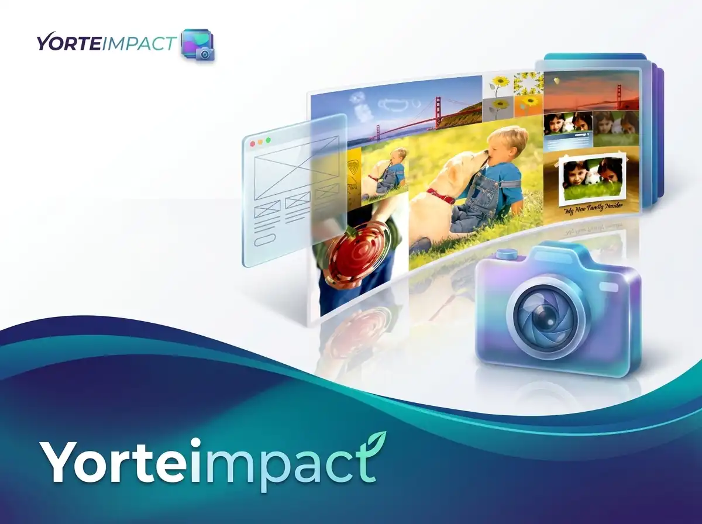

<p align="center">
  
</p>

# YorteImpact

A fast desktop tool for prototyping page layouts: place shapes, images and
text on a canvas, style them, slice regions and export the result. Built with
WPF on .NET 8.

- Flat Z-order (bring forward / back), no layer tree.
- Vector shapes with solid or gradient fills, borders, rounded corners,
  shadows, soft edges and directional transparency.
- Editable text with RTL support, font search, wrapping, spacing and shadows.
- Slice-based copy, cut and export; transparent PNG output.
- Image import from the clipboard or by drag-and-drop.
- Dark, compact interface with a resizable inspector.

## Requirements

- Windows 10 or 11.
- .NET 8 SDK (WPF workload).
- NuGet restores `SixLabors.ImageSharp` on the first build (WebP export).

## Getting started

```powershell
dotnet run
```

The editor opens on a **default canvas** (2000 × 2000, white). Change the
startup default in **Settings** (gear button in the top bar, or `Ctrl+,`); the
value is stored in `%AppData%\YorteImpact\settings.json`.

**New** (`Ctrl+N`) opens the **New Canvas** dialog:

- **Manual** — type the pixel size and see a live aspect-ratio preview.
- **Web / Paper / Mobile / Social** — visual preset cards.
- Background: **White** or **Transparent** (color can be changed later).

## Workspace

### Top bar

New, Open, Save / Save As, project name and canvas size, zoom controls and
Settings.

**Save** chooses the format from the dialog's file type:

- `.yimpact` — editable project.
- `.png` — lossless image.
- `.gif` — static, 256 colors.
- `.webp` — quality 90.

**Save As** (`Ctrl+Shift+S`) always opens the dialog.

### Left rail

Tools only, with thin group dividers:

| Tool | Key | Purpose |
|---|---|---|
| Pick | `V` | Select, move, resize, rotate |
| Slice | `M` | Draw export/copy regions |
| Rectangle | `R` | Draw a shape |
| Text | `T` | Type text in place |
| Eyedropper | `I` | Sample a color anywhere (sits above the color well) |
| Background remover | `E` | Erase a connected color / auto background |

Below the tools: undo, redo, duplicate, delete, the working-color well and
zoom in/out.

### Attribute bar

Shows the active tool's options:

- **Pick** — transparency, corner radius, soft edge, order, alignment and
  flip.
- **Slice** — the *Add slice* toggle.
- **Background remover** — tolerance, contiguous mode and *Auto*.
- Other tools show a one-line hint.

### Inspector

The right panel is made of cards and is resizable by dragging its inner edge:

- **Geometry** — X/Y and W/H on two compact rows, then Corner.
- **Rotation** — rotation slider and the 90° left/right buttons.
- **Appearance** (shapes) — solid or gradient fill, colors, gradient type
  and angle, border color and thickness.
- **Text** — font search and list, size, B/I/U/S and alignment.
- **Fill** (text) — solid or gradient text fill.
- **Transparency** — directional fade-to-transparent.
- **Extra settings** (text) — letter spacing, line spacing, width limit and
  drop shadow.
- **Shadow** (shapes and images) — presets plus custom offset, blur, opacity
  and color.
- **Workflow** — a short reminder of common actions.

Value fields use a near-black borderless style; card titles are brighter than
the muted field labels. The inspector has a thin dark scrollbar.

## Canvas objects

### Shapes

Draw with the Rectangle tool. Shapes support:

- Solid or gradient fill (**Linear / Radial / Elliptical**) with an angle.
- Border color and thickness.
- Corner radius.
- Rotation, flip, opacity.
- Shadows, soft edge and directional transparency.

The drawing preview shows the final fill, border and corner radius before you
release the mouse.

### Images

Paste from the clipboard (`Ctrl+V`) or drag image files onto the canvas.
Images scale to a sensible size, support rounded corners, rotation, shadows
and the same transparency/soft-edge controls as shapes.

### Text

Click the canvas and type in place; `Enter` adds a line, `Esc` or clicking
outside finishes. Double-click a text object with **Pick** to edit it again.
Empty text is discarded.

The **Text** card includes:

- **Font search** and a list where every name is rendered in its own font.
  Hover or use `↑` / `↓` to preview, `Enter` or click to apply, `Esc` to
  restore the previous font.
- Size and enclosed **B / I / U / S** controls.
- **Alignment**: left, center or right. Hebrew/Arabic text is ordered RTL and
  Latin text LTR automatically.

A separate **Fill** card sets solid or gradient text fill. **Extra settings**
(closed by default) holds letter spacing, line spacing, width limit with word
wrap, and a drop shadow.

Resizing a text object with the Pick handles scales its font. Text objects are
saved as editable elements in `.yimpact`.

### Selection and transforms

- Click to select; a 1px animated outline hugs the actual opaque pixels.
- Drag to move; corner and side handles resize (Shift keeps proportions).
- Rotate with the slider or the 90° buttons.
- Arrow keys nudge by 1px (Shift = 10px).

### Order and alignment

Bring to front / forward / backward / back, plus alignment to the canvas:

- left / horizontal center / right,
- top / vertical center / bottom,
- a center button that aligns both axes.

### Soft edge

Feathers the four borders of an object to transparency (0–100%). The feather
is rectangular, so the interior and corners stay solid and a square stays a
square. It is honored by copy and export.

### Transparency gradient

Open the collapsible **Transparency** card under the fill cards:

- **Direction** — top/bottom, left/right or either diagonal (8 options).
- **Strength** — how transparent the faded end becomes (0 = no fade,
  100 = fully transparent).
- **Start / End** — where the opaque plateau ends and where the faded level is
  reached. For example: Start 0 / End 30 fades quickly from the edge;
  Start 80 / End 100 stays opaque until the far edge.

It applies to shapes, images and text and is saved in the project.

### Shadows

- Shapes/images: presets (Soft, Medium, Hard, Long, Glow) plus offset, blur,
  opacity and color.
- Text: a simple shadow with offset, blur, opacity and color under Extra
  settings.

## Slicing and clipboard

### Slice

Each drag replaces the slice; enable **Add slice** to accumulate several
regions. Click a region to activate it.

- `Ctrl+C` copies the active slice area.
- `Ctrl+X` cuts it out.
- `Delete` cuts the slice area out of the selected object.
- `Space` shows/hides the slice markers (hidden markers are inactive).

Leaving the Slice tool hides and resets the markers.

### Copy / Cut / Paste

- `Ctrl+C` copies the visible slice area of the selected object (or the slice
  area of the canvas when nothing is selected). With no slice it copies the
  whole selected object.
- Copied pixels also go to the OS clipboard as a bitmap and PNG, so they can
  be pasted into other applications.
- `Ctrl+X` copies and removes: a slice over a selected object is punched out;
  otherwise the whole object is cut.
- `Ctrl+V` pastes a fresh system image when available; otherwise it stamps the
  internal copy in place.

## Colors

- The **Eyedropper** samples exact pixels anywhere on screen, including shape
  gradients and image pixels. The sample becomes the working color.
- The in-app **Color Picker** has a saturation/value field, hue strip, hex and
  RGB entry, palette swatches and colors already used on the canvas.
- Color changes are **previewed live on the canvas** while the picker is open.
  **OK** keeps the preview, **Cancel** restores the previous color. The whole
  picker session is one undo step.
- The **Background remover** erases a connected color (magic wand) or the
  background connected to an image border.

## Navigation

- `+` / `-` (main keyboard and numpad) step through a zoom ladder that always
  includes 100%.
- `Ctrl+0` resets to 100%; `Ctrl+wheel` zooms at the cursor.
- Canvases auto-fit on open.
- When the whole canvas fits, scrolling is disabled; otherwise it spans the
  canvas.
- The window title shows the current zoom.

## Undo and redo

Snapshot-based, 40 steps. A drag is one step; typing coalesces per focus
session. New canvas and Open are undoable.

## Files

### Project (`.yimpact`)

JSON with embedded PNG image data, so clipboard-pasted images survive a
save/load round-trip. Stores canvas size/color/transparency, elements,
text styling, shadows, soft edges and transparency gradients.

### Image export

Flat PNG, GIF or WebP at the canvas resolution. Transparent canvases export
with alpha.

## Keyboard shortcuts

| Shortcut | Action |
|---|---|
| `V` / `M` / `R` / `T` / `I` / `E` | Pick / Slice / Rectangle / Text / Eyedropper / Background remover |
| `Ctrl+N` | New canvas |
| `Ctrl+O` | Open project |
| `Ctrl+S` | Save |
| `Ctrl+Shift+S` | Save As |
| `Ctrl+Z` | Undo |
| `Ctrl+Y` or `Ctrl+Shift+Z` | Redo |
| `Ctrl+C` / `Ctrl+X` / `Ctrl+V` | Copy / Cut / Paste |
| `Ctrl+D` | Duplicate |
| `Ctrl+F` | Pick the selected shape's fill color |
| `Ctrl+R` | Fit canvas to selection |
| `Ctrl+0` | Zoom to 100% |
| `+` / `-` | Zoom step |
| `Ctrl+wheel` | Zoom at cursor |
| `Delete` / `Backspace` | Delete (cuts the slice when one is active) |
| `Space` | Show/hide slice markers |
| Arrow keys | Nudge 1px (Shift = 10px) |
| `Esc` | Finish text / clear slice / return to Pick |
| `Ctrl+,` | Settings |

## Notes

- Single selection; `DesignDocument.Selected` is the extension point.
- Slice punch supports axis-aligned elements; rotated elements fall back to
  whole-element delete.
- Z-indexes normalize to 0..N after every reorder.
- Letter spacing uses a dedicated text renderer; zero spacing uses the native
  text engine.
